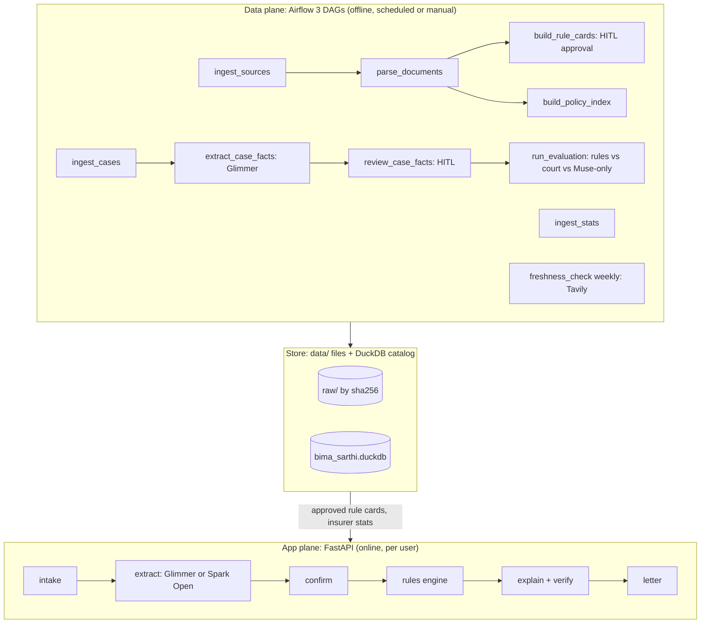

Bima Sarthi is an independent project, not affiliated with IRDAI, LIC or any insurer.

# Bima Sarthi

Checks an Indian health-insurance claim decision against verified IRDAI rules, and tells you what to do next and by when.

**This is a rules check, not legal or medical advice.** It never promises an outcome.

## What it does

You upload photos or PDFs of a rejection letter, a settlement letter or a policy document (JPG, PNG or PDF; at most 20 pages and 25 MB). The app:

1. reads them with a vision model and extracts facts, each with its source quote, page and confidence;
2. asks you to confirm or correct every fact (low-confidence ones are highlighted);
3. runs a deterministic rule engine over human-approved rule cards, giving one verdict per finding (CONSISTENT, CHALLENGEABLE or NEED_INFO), each with the verbatim regulation quote and your document's quote;
4. explains the result in English and Hindi, from fixed, verified templates (optional English rephrasing by Spark Open is off by default and only enabled with `SARTHI_REPHRASE=1`; Hindi is always template-only), and a verifier rejects any number or promise not found in the findings;
5. produces a grievance letter with deadlines.

Scope: full rejections, part-payments and cashless delays. Users are policyholders and helpers (Bima Sakhis, local agents); helper mode switches to third-person wording and adds a printable summary.

**Models read; code decides.** Verdicts come only from rule cards a person has approved, and each card's quote is checked verbatim against its stored source page.

## The problem (from published reports)

- Insurance Ombudsman (CIO) annual report 2023-24: 31,490 health-insurance complaints (secondary source: CIO Annual Report 2023-24).
- IRDAI annual report: ₹26,000 crore of claims disallowed or repudiated in FY24, up 19.1% (IRDAI annual report FY24 — to be confirmed against the stored report).

## Architecture

Two planes share one data store and one rules package.



- **Data plane.** Airflow 3 DAGs in `dags/`. Pipeline logic lives in the importable `sarthi.data` package; the DAGs only wire steps together, so every step also runs from the CLI. DAG screenshots: _to be added from the running Airflow UI._
- **App plane.** FastAPI (`sarthi/app/main.py`). It reads only approved rule cards (the policy index is built and evaluated but is not used by the app in v1: `EXCLUSION_LISTED` returns "need info" and asks the user; a lookup miss never becomes "not excluded"). User documents never enter the store: they live in a session temp folder and are deleted after the result or after 1 hour.

### Human-in-the-loop gates

Two Airflow 3.1+ approval gates: a person approves each rule card before it goes live, and reviews each case's extracted facts before they enter evaluation. Rejected items loop back with a note.

## Models

Built with Muse Spark Open. Glimmer (Apache 2.0) reads documents and extracts case facts; Spark Open reads and extracts in the hosted demo, acts as a model-only baseline in the evaluation, and optionally rephrases English explanations (off by default; `SARTHI_REPHRASE=1`). Every result records which model produced it.

Fallback ladder (`models.yaml`; see `deploy/README.md`):

| Rung | Model | Served by |
|---|---|---|
| 1 `hpc48` | Glimmer Q8 + mmproj, vision | HPC GPU slice (48 GB) |
| 2 `hpc24` | Glimmer UD-Q4_K_XL, vision | HPC GPU slice (24 GB) |
| 3 `kaggle` | Glimmer Q4 on 2 T4 | Kaggle notebook |
| 4 `baseten` | Spark Open | hosted on Baseten |
| 5 `ollama_dev` | Llama 3.2 3B, text only, development only | local Ollama |

## Data sources

Real data only; no synthetic cases. Every row derived from a document carries its `source_sha256` and `page_no`, so any number on screen traces to a stored file and page.

| Dataset | What | Use |
|---|---|---|
| IRDAI regulations and master circulars (health master circular 29 May 2024; Insurance Products Regulations 2024; policyholder-protection rules) | public | rule-card quotes and in-force dates |
| Insurance Ombudsman Rules 2017 | public | grievance route and deadlines |
| Arogya Sanjeevani wordings and CIS, from each insurer that sells it | insurer sites | clause index; uniformity check |
| Consumer-commission and court judgments on health-claim rejections | Indian Kanoon API, powered by IKanoon | the real case set for evaluation and the gallery |
| CIO and IRDAI annual reports | public | problem evidence; insurer context |

Ombudsman awards are not public (each can only be downloaded by its complainant), so they are not used.

Hashes: the SHA-256 of every stored source is recorded in the `source` table and not repeated by hand here. Fill this table from the real store:

```
SELECT source_id, sha256 FROM source ORDER BY source_id;
```

| source_id | sha256 |
|---|---|
| _to be filled from the query above_ | _pending_ |

## Evaluation

Run on real, human-reviewed court judgments (not generated cases): the rule engine on reviewed facts is compared with what the court decided, against Glimmer-only and Spark-only baselines that get the same facts and the regulation text. Reading accuracy is measured separately.

**All numbers below are pending**: they are filled from `docs/eval/report.md` only after `cli eval` has run on the real reviewed cases.

| Measure | rules | glimmer_only | spark_only |
|---|---|---|---|
| Cases (n) | pending | pending | pending |
| Agreement with court outcome | pending | pending | pending |
| False-hope rate (we said challengeable, the court dismissed) | pending | pending | pending |
| Abstentions | pending | pending | pending |
| Quote coverage | pending | pending | pending |
| Stability over 3 repeats | pending | pending | pending |
| Cost (USD) | pending | pending | pending |

| Reading and lookup | Result |
|---|---|
| Field accuracy on consented documents (n documents) | pending |
| Wrong fields flagged for confirmation | pending |
| Clause-lookup hit rate over every Arogya Sanjeevani wording (n lookups) | pending |

### Limitations

- Courts weigh evidence that the rules don't see, so agreement under 100% is expected. Disagreements are reported case by case in `docs/eval/report.md`.
- Reading accuracy is measured on n consented documents (a small number, so it is stated with n and not generalised). Those documents are never published.
- Verdicts reflect the regulation and the rule cards at the date stated on each card; a rule's in-force dates are shown.
- Open questions, with the v1 decisions: Q-005 (does the 60-month moratorium apply to policies started before 1 Apr 2024, from their next renewal) and Q-006 (exact scope of the claims review committee requirement) are open until Parth answers them from the primary text (Task 6 Step 5); until then every rule card is draft and no verdict is live; Q-007 Hindi templates are pending human review, and Hindi explanations are template-only (no model rephrasing); Q-008 no data donation in v1.

## Privacy

User documents are never stored in the data store, never published and never shown to external services other than the model that reads them. Session files live in a temp folder and are deleted after the result or after 1 hour. The hosted demo reads and writes through Baseten. The gallery uses real judgment cases with their citations, never real users.

## Built during the hackathon

The first commit in this repository is on or after 27 Oct 2026, within the hackathon window (Meta Global AI Developer Hackathon, Indie track).

## Run it

```
uv sync
uv run pytest
uv run --env-file .env uvicorn sarthi.app.main:app --reload       # the web app
```

Data CLI (`uv run --env-file .env python -m sarthi.data.cli <subcommand>`):

```
fetch --discover [--id ID] [--write-urls] [--replace]   (Firecrawl finds and downloads the PDFs)
fetch --all | register-local <file> --id <id> | parse --all
rules load | rules verify | rules approve <id> --version N --by <you>
policy build --product-id P --sha S | policy report
cases search|fetch|add-local|extract        stats load        literature search <q>
eval --methods rules glimmer_only spark_only --repeats 3
eval-reading --docs <consented folder> --truth <truth.json>
eval-clauses
```

Airflow: `AIRFLOW_HOME=$PWD/.airflow uv run --env-file .env --group airflow airflow standalone`. Keys go in `.env` (names listed in `.env.example`); none are committed.

## Credits

Built with Muse Spark Open. Judgment data powered by IKanoon. Licences: see `LICENSES.md` and `LICENSE` (MIT).
